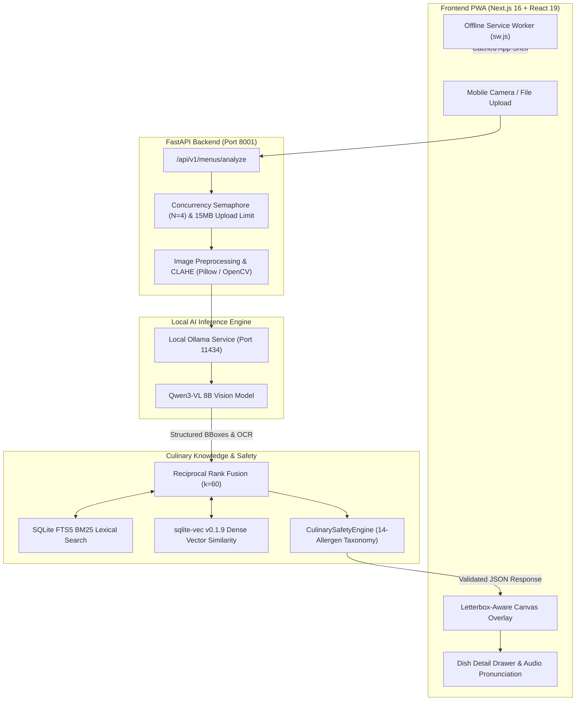

# Menu Translator — Local AI Culinary Lens

[](LICENSE)
[](https://www.python.org/)
[-black.svg)](https://nextjs.org/)
[](https://ollama.com)
[](https://hacktoberfest.com/)

A **privacy-preserving, locally deployable restaurant menu translator and dietary allergen scanner** designed for the **Hacktoberfest Open-Source AI Challenge**.

Menu Translator enables diners and travelers to point their camera at any physical restaurant menu, extract printed dishes in natural reading order, cross-reference an embedded culinary knowledge base using hybrid search (FTS5 + dense vectors), and receive evidence-grounded translations, phonetic pronunciation, and dietary warnings without transmitting private photos to third-party cloud APIs.

---

## 🏛️ System Architecture



---

## ✨ Key Features

- **100% Local On-Device Inference**: Powered by local Ollama (`qwen3-vl:8b`); zero external paid cloud API dependencies, zero recurring API costs.
- **Strict Zero False-Safe Mandate**: Inferred allergen absence is **never** presented as proof that a dish is safe. Unverified ingredients are explicitly flagged as `not_listed` or `unknown`.
- **Hybrid RAG Culinary Knowledge Base**: Combines SQLite FTS5 lexical BM25 matching and `sqlite-vec` (v0.1.9) dense vector similarity fused via Reciprocal Rank Fusion ($k=60$).
- **Cross-Restaurant Data Isolation**: Strict tenant scoping ensures proprietary restaurant recipes never leak across distinct establishments.
- **Letterbox-Aware Canvas Overlay**: Mathematically precise bounding box scaling mapping normalized coordinates ($0.0 \le \text{coord} \le 1.0$) to displayed images across all mobile and desktop aspect ratios with responsive zoom/pan.
- **Accessible Multi-Sensory UI**: Dietary conflicts are flagged via high-contrast borders, warning icons, and textual badges (never color alone), complete with ARIA roles and keyboard navigation.
- **Audio Pronunciation**: Integrated Web Speech API audio synthesis for authentic dish names in native languages.
- **Multilingual Support**: Supports 10 target languages including RTL Arabic (`ar`), Japanese (`ja`), Chinese (`zh`), French (`fr`), Italian (`it`), Spanish (`es`), and German (`de`).
- **Offline PWA Shell**: Fully installable Progressive Web App with service worker caching for safe static assets.

---

## 🚀 Quickstart Guide

### 1. Prerequisites
- **Python**: 3.11+ (Tested on Python 3.14)
- **Node.js**: 20+ (Tested on v24 LTS) & npm 10+
- **Ollama**: Download and install from [ollama.com](https://ollama.com)

### 2. Pull Local Vision Model
Ensure Ollama is running in the background, then pull the vision model:
```bash
ollama pull qwen3-vl:8b
```
*(For machines with $\le 6\text{ GB}$ VRAM, you can also use `ollama pull qwen2.5vl:3b` and set `VISION_MODEL=qwen2.5vl:3b` in `.env`)*.

---

### 3. Backend Setup

```bash
# From repository root
cd c:/local_disc_D/Hackathan/Hack_to_october

# Setup Python virtual environment
python -m venv backend/.venv

# Activate environment (Windows PowerShell)
backend\.venv\Scripts\Activate.ps1
# Linux/macOS: source backend/.venv/bin/activate

# Install dependencies
pip install -r backend/requirements.txt

# Run backend development server (Port 8001)
$env:PYTHONPATH="."
python -m uvicorn backend.app.main:app --host 127.0.0.1 --port 8001 --reload
```

Interactive OpenAPI Swagger docs will be available at: [http://127.0.0.1:8001/docs](http://127.0.0.1:8001/docs)

---

### 4. Frontend Setup

```bash
# In a new terminal
cd frontend

# Install dependencies
npm install

# Run frontend development server (Port 3001)
npm run dev -- -p 3001
```

Open [http://localhost:3001](http://localhost:3001) in your browser!

---

## 🧪 Running Automated Tests

```bash
# Run all 85 backend unit, integration, and security tests:
$env:PYTHONPATH="."
pytest -v

# Run frontend linting & Next.js production build:
cd frontend
npm run lint
npm run build
```

---

## 📊 Evaluation & Benchmark Reports

- **[docs/dataset-card.md](docs/dataset-card.md)**: Dataset source inventory, licenses, language coverage, and synthetic corpus (`mt-synth-v1`) documentation.
- **[docs/model-card.md](docs/model-card.md)**: Base model architecture, safety boundaries, intended/unintended uses, and rollback criteria.
- **[docs/baseline-evaluation-report.md](docs/baseline-evaluation-report.md)**: Measured metrics on frozen test set ($1.00$ IoU, $0.00$ CER, $100\%$ Price Association, $0.00\%$ False-Safe Rate).
- **[docs/performance-benchmark-report.md](docs/performance-benchmark-report.md)**: Stage-by-stage timings ($p_{50}$ and $p_{95}$ percentiles) under concurrent load.
- **[docs/security-and-privacy.md](docs/security-and-privacy.md)**: Threat model, ephemeral memory processing, deletion policies, and anti-injection defenses.
- **[docs/DEMO_WALKTHROUGH.md](docs/DEMO_WALKTHROUGH.md)**: Live demonstration and presentation script.
- **[docs/FINAL_RELEASE_REPORT.md](docs/FINAL_RELEASE_REPORT.md)**: Engineering retrospective and release report.

---

## 🛡️ Safety & Medical Disclaimer

> [!CAUTION]
> **Not a Certified Medical Diagnostic Tool**:
> Menu Translator is an informational culinary assistant. It is **NOT** certified for clinical allergen testing and must **NEVER** be used as the sole safety mechanism for life-threatening anaphylactic food allergies. Always verbally cross-check with restaurant kitchen staff.

---

## 🤝 Contributing

Contributions are warmly welcomed for Hacktoberfest! Check out [CONTRIBUTING.md](CONTRIBUTING.md) for local development guidelines, coding standards, and issue templates.

## 📄 License

Licensed under the [Apache License, Version 2.0](LICENSE).
