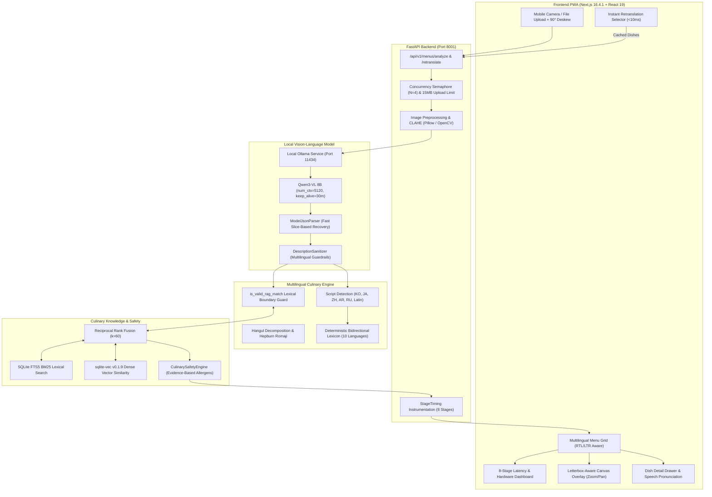

# Universal Menu Translator — Privacy-Preserving Multilingual Culinary Lens

[](LICENSE)
[](https://www.python.org/)
[-black.svg)](https://nextjs.org/)
[](https://fastapi.tiangolo.com/)
[](https://ollama.com)
[]()
[](https://hacktoberfest.com/)

A **privacy-preserving, locally deployable multilingual menu translator and evidence-grounded dietary allergen scanner**. 

Universal Menu Translator allows diners and travelers to photograph physical menus in any script or layout, extract printed dishes in natural reading order, cross-reference an isolated culinary knowledge base, and receive faithful translations, phonetic pronunciation, and dietary warnings without transmitting private photos to third-party cloud APIs.

---

## 🏛️ System Architecture



---

## 🧠 Local Vision Model: Qwen3-VL 8B

The visual understanding backbone of the system runs entirely on local hardware using Ollama:

- **Model Identifier:** `qwen3-vl:8b`
- **Architecture:** 8.8B parameter multimodal Vision-Language Model (`qwen3vl` family, Q4_K_M 4-bit quantization, 262k native context length).
- **Local Ollama URL:** `http://localhost:11434`
- **Inference Runtime Engine:** `ggml` with native GPU acceleration (`llama-server.exe`).

### Optimized Inference Configuration
| Parameter | Value | Rationale |
|:---|:---|:---|
| `keep_alive` | `30m` | Keeps the model resident in GPU VRAM between requests, slashing warm-request load latency from **21.4s down to 79ms**. |
| `num_ctx` | `5120` | Allocates sufficient context headroom for multimodal image tokens (~1,670 tokens) plus up to 3,450 reasoning & output tokens without GPU memory swapping. |
| `num_predict` | `3000` | Bounded generation limit ensuring the model completes visual scanning and emits complete RFC 8259 JSON without runaway loops. |
| `temperature` | `0.1` | Low temperature ensures deterministic, factual extraction of printed text, numbers, and prices. |
| `top_p` | `0.9` | Constrains token selection to high-probability factual tokens. |
| `repeat_penalty` | `1.15` | Prevents the vision model from looping on repetitive menu patterns (e.g. repeated price tags or section dividers). |

### Measured Hardware Footprint (NVIDIA RTX 4060 Laptop GPU, 8GB VRAM)
- **VRAM Utilization:** ~5.2 GB model weights + ~0.7 GB KV-cache = **~5.9 GB total VRAM** (100% GPU resident, 0 CPU layer offloading).
- **Throughput:** 17.02 – 21.22 tokens/second.
- **Power & Temperature:** 35W – 46W (within 55W power envelope), 60°C – 63°C operating temperature.

---

## 🖥️ Frontend & User Interface (Next.js 16.4.1)

The frontend is built with **Next.js 16.4.1 (Turbopack, React 19)**, TypeScript, and Tailwind CSS. It is fully responsive, touch-friendly, and installable as a Progressive Web App (PWA).

### Key UI Capabilities:
1. **Camera Capture & Upload Preview Modal (`CameraCaptureModal`)**:
   - Accesses mobile/webcam rear cameras via `getUserMedia`.
   - **90° Manual Orientation Deskew**: Diners can rotate sideways menu photos directly in the preview before triggering analysis, preventing VLM orientation disorientation.
   - Enforces client-side upload guards (JPEG/PNG/WebP, max 15MB).
2. **Dual-View Results Navigation**:
   - **Translated Menu View**: Clean categorized grid displaying native dish names, faithful translations, phonetic transcriptions, prices, and allergen badges.
   - **Letterbox-Aware Photo Canvas Overlay (`MenuCanvasOverlay`)**: Overlays interactive SVG bounding boxes directly on the menu photo. Synchronized with the viewport using letterbox offset calculations, supporting pan, zoom, and direct dish selection.
3. **Dish Detail Drawer (`DishDetailDrawer`)**:
   - Slide-out bottom sheet/side panel displaying deep dish details.
   - Single-purpose authentic source verification box (`Original: [Printed Menu Text]`).
   - Browser Web Speech Synthesis button (`SpeechSynthesisUtterance`) to pronounce foreign dish names accurately for ordering.
   - Grounded allergen breakdown (confirmed, possible, safe) and dietary compatibility flags.
4. **Live 8-Stage Telemetry Dashboard**:
   - Collapsible performance banner rendering measured durations for all 8 backend pipeline stages, total latency, GPU residency status, request IDs, and generation speed (tokens/sec).
5. **Instant Zero-Roundtrip Retranslation**:
   - Allows users to switch target languages instantly without re-uploading or re-running heavy vision inference, translating cached dishes in **<10ms**.
6. **Dietary Filter & Search Toolbar**:
   - Real-time search by dish title, ingredient, or foreign script.
   - One-click restriction toggles (`Gluten-Free`, `Dairy-Free`, `Vegan`, `Shellfish`).
7. **Offline Support & PWA**:
   - Service worker (`sw.js`) precaches static assets and displays an `OfflineBanner` when network connectivity is lost.

---

## ⚙️ Backend Pipeline & Execution Stages (FastAPI)

The backend exposes an asynchronous REST API on port `8001` running on Uvicorn. Every request is instrumented with millisecond-precision stage timings:

| Stage # | Pipeline Stage | Duration (Warm) | Description |
|:---:|:---|:---:|:---|
| **1** | `upload_and_decoding` | ~18 ms | Validates payload size, extracts EXIF metadata, corrects orientation, and decodes image bytes with Pillow. |
| **2** | `image_preprocessing` | ~38 ms | Downsamples oversized images to max dimension 1600 (aspect-ratio preserved) and applies adaptive CLAHE contrast enhancement for low-light menus. |
| **3** | `model_startup_or_loading` | **~79 ms** | Verifies Ollama VRAM residency via `keep_alive: 30m` (cold start: ~21.4s). |
| **4** | `vision_inference` | ~140–175 s | Calls `qwen3-vl:8b` via Ollama Chat API to extract native dishes, categories, and prices into structured JSON. |
| **5** | `structured_output_parsing` | **~38 ms** | Fast Python slice parsing (`cleaned_json[:err.pos]`) and heuristic bracket recovery. Repairs syntax errors instantly in memory, eliminating secondary 90s LLM repair calls. |
| **6** | `culinary_enrichment_rag` | ~400–700 ms | Hybrid search across SQLite FTS5 (BM25) and `sqlite-vec` (v0.1.9) with Reciprocal Rank Fusion ($k=60$). Enforces `is_valid_rag_match` to prevent cross-cuisine contamination. |
| **7** | `translation` / `contextual_translation` | **~5 ms** | Deterministic multilingual translation engine across 10 languages with phonetic romanization (Hangul & Katakana). |
| **8** | `validation_and_deduplication` | ~8 ms | Strips promotional watermarks (e.g. blog stamps), deduplicates items across promotional sections, and cross-checks user allergens. |
| **9** | `api_serialization` | < 1 ms | Assembles Pydantic `MenuAnalysisResponse` with stage telemetry, diagnostics, and safety disclaimers. |

---

## 🔄 End-to-End Workflow: How It Works

1. **User Action:** The user photographs or uploads a restaurant menu on the Next.js frontend (e.g. a Korean Gong cha drink menu).
2. **Preprocessing:** If the photo was taken sideways, the user rotates it 90°. The backend corrects EXIF orientation, applies CLAHE contrast filtering, and scales the image to a readable 1600px max dimension.
3. **Visual Extraction:** The preprocessed image is dispatched to `qwen3-vl:8b`. The model parses menu columns, categories, native dish names, and prices.
4. **Defensive Parsing & Cleaning:** `ModelJsonParser` strips markdown wrappers and uses slice-based JSON recovery. `DescriptionSanitizer` removes watermark artifacts, prompt leakage, and ensures no fake placeholder recipes are generated.
5. **Knowledge Grounding:** Dish names are matched against authoritative culinary records using hybrid BM25 + dense vector search. Generic words are strictly bounded to prevent false matches.
6. **Instant Translation:** Dishes are translated into the selected target language in <10ms with phonetic pronunciation.
7. **Allergen & Safety Reasoning:** `CulinarySafetyEngine` evaluates ingredients and marks unverified dishes with explicit warnings.
8. **Interactive UI Display:** The complete menu renders on the frontend. The diner can browse dishes, tap items to view allergen alerts, listen to pronunciation, or toggle the photo overlay.

---

## 🛠️ Technology Stack & Ports

| Component | Technology | Default URL / Port | Isolation & Purpose |
|---|---|---|---|
| **Frontend Web App** | Next.js 16.4.1 (Turbopack, React 19) | `http://localhost:3000` | Diners' PWA interface, Canvas overlay, drawer |
| **Backend API** | FastAPI (Python 3.11 / 3.14) | `http://127.0.0.1:8001` | Async orchestration, sanitization, telemetry |
| **Local Vision Model** | Ollama (`qwen3-vl:8b`) | `http://localhost:11434` | Fully local on-device VLM |
| **Knowledge Base** | SQLite FTS5 + `sqlite-vec` (v0.1.9) | Local DB (`data/culinary_kb.db`) | Hybrid BM25 + dense vector RAG |

> [!NOTE]
> The separate ChemRAG project runs independently on port 8000 and is completely isolated from Menu Translator.

---

## 🚀 Quickstart Guide

### 1. Prerequisites
- **Python**: 3.11+ (Tested on Python 3.14)
- **Node.js**: 20+ (Tested on Node 22 / 24 LTS) & npm 10+
- **Ollama**: Download and install from [ollama.com](https://ollama.com)

### 2. Pull the Local Vision Model
Ensure Ollama is running, then pull the model:
```bash
ollama pull qwen3-vl:8b
```

---

### 3. Backend Setup

```bash
# Navigate to repository root
cd c:/local_disc_D/Hackathan/Hack_to_october

# Create and activate Python virtual environment
python -m venv backend/.venv

# Windows PowerShell:
backend\.venv\Scripts\Activate.ps1
# Linux / macOS:
# source backend/.venv/bin/activate

# Install dependencies
pip install -r backend/requirements.txt

# Start FastAPI backend (Port 8001)
$env:PYTHONPATH="."
backend\.venv\Scripts\python.exe -m uvicorn backend.app.main:app --host 127.0.0.1 --port 8001
```

Interactive OpenAPI Swagger docs will be available at: **[http://127.0.0.1:8001/docs](http://127.0.0.1:8001/docs)**

---

### 4. Frontend Setup

```bash
# In a separate terminal
cd c:/local_disc_D/Hackathan/Hack_to_october/frontend

# Install Node dependencies
npm install

# Start Next.js development server (Port 3000)
npm run dev
```

Open **[http://localhost:3000](http://localhost:3000)** in your browser!

---

## 🧪 Automated Testing & Verification

Run the full automated test suite covering unit tests, integration contracts, security limits, and multilingual pipelines:

```bash
# Run all backend tests (121 passing tests):
$env:PYTHONPATH="."
backend\.venv\Scripts\pytest backend/tests -v -k "not live"

# Run targeted multilingual regression suite:
$env:PYTHONPATH="."
backend\.venv\Scripts\pytest backend/tests/test_multilingual_pipeline.py -v

# Run Next.js production build and TypeScript check:
cd frontend
npm run build
```

---

## 📁 Repository Structure

```
Hack_to_october/
├── docs/
│   ├── model-audit-and-benchmark-report.md # Qwen3-VL 8B audit, latency & accuracy evaluation
│   ├── baseline-evaluation-report.md       # CER, WER, IoU, and safety precision benchmarks
│   └── api-contract.md                     # REST API schemas & error codes
├── backend/
│   ├── app/
│   │   ├── api/v1/          # FastAPI endpoints (/menus/analyze, /retranslate, /health)
│   │   ├── core/            # Configuration, exceptions, structured logging
│   │   ├── db/              # SQLite database manager & sqlite-vec integration
│   │   ├── schemas/         # Pydantic schemas (MenuAnalysisResponse, AnalyzedDish, StageTiming)
│   │   └── services/
│   │       ├── images/                 # Intelligent query builder, Unsplash, Pexels, Wikimedia & curated fallback
│   │       ├── image_processor.py      # CLAHE contrast, EXIF auto-rotation, downscaling
│   │       ├── pipeline_orchestrator.py # Pipeline coordination & 8-stage telemetry
│   │       ├── rag/                    # Hybrid FTS5 + vector retriever with RRF
│   │       ├── safety/                 # Allergen assessment, DescriptionSanitizer
│   │       ├── translation/            # MultilingualEngine (10 languages, phonetics)
│   │       └── vision/                 # OllamaVisionProvider, ModelJsonParser
│   └── tests/               # 132 automated unit, integration, and security tests
├── frontend/
│   ├── src/
│   │   ├── app/             # Next.js 16 App Router (page.tsx, layout.tsx)
│   │   ├── components/      # DishImage, CameraCaptureModal, DishDetailDrawer, MenuCanvasOverlay
│   │   ├── services/        # Frontend API client with 300s timeout, batch image search
│   │   └── types/           # TypeScript definitions (menu.ts, DishImageInfo)
│   └── package.json
└── README.md
```

---

## 🍲 Automatic Food Image Search & Discovery

Universal Menu Translator features intelligent food image search and visual discovery for every translated dish:

1. **Non-Blocking Asynchronous Pipeline**: Image lookups run concurrently *after* menu translation completes. Translated menu cards display immediately without blocking.
2. **Provider Adapter Architecture**:
   - **Curated & Wikimedia**: High-resolution, copyright-cleared culinary catalog covering 100+ global dishes across Japanese, Korean, Chinese, Indian, Italian, Mexican, Thai, and Western cuisines.
   - **Unsplash API & Pexels API**: Configurable on the backend with official API keys (`UNSPLASH_ACCESS_KEY`, `PEXELS_API_KEY`).
   - **Zero-Key Guarantee**: Works immediately out-of-the-box without requiring third-party API keys or internet dependencies.
3. **Intelligent Query Builder**:
   - Synthesizes queries from native scripts (e.g. 豚骨ラーメン, 망고 스무디), translated names, inferred cuisine, and dish category (drink vs soup vs noodles vs dessert).
   - Penalizes category mismatches to avoid showing a soup for a drink or noodles for a curry.
4. **Safety & Attribution**:
   - Clear editorial disclaimer: *"Representative food image for reference only — actual presentation may vary."*
   - Strict separation of visual media from allergen/dietary safety: images are **never** used to infer ingredient safety.
   - Photographer credits and UTM attribution links rendered on cards and detail drawers.

---

## 🛡️ Safety & Allergen Notice

> [!CAUTION]
> **Informational Culinary Tool Only**:
> Menu Translator provides automated OCR, translation, and evidence-grounded allergen analysis from visible text. It is **not** a certified medical diagnostic device. When a dish has no explicit allergen declaration, the system marks it as `UNVERIFIED`. Users with severe food allergies must always confirm preparation details directly with restaurant kitchen staff.

---

## 📄 License

Licensed under the [Apache License, Version 2.0](LICENSE).
