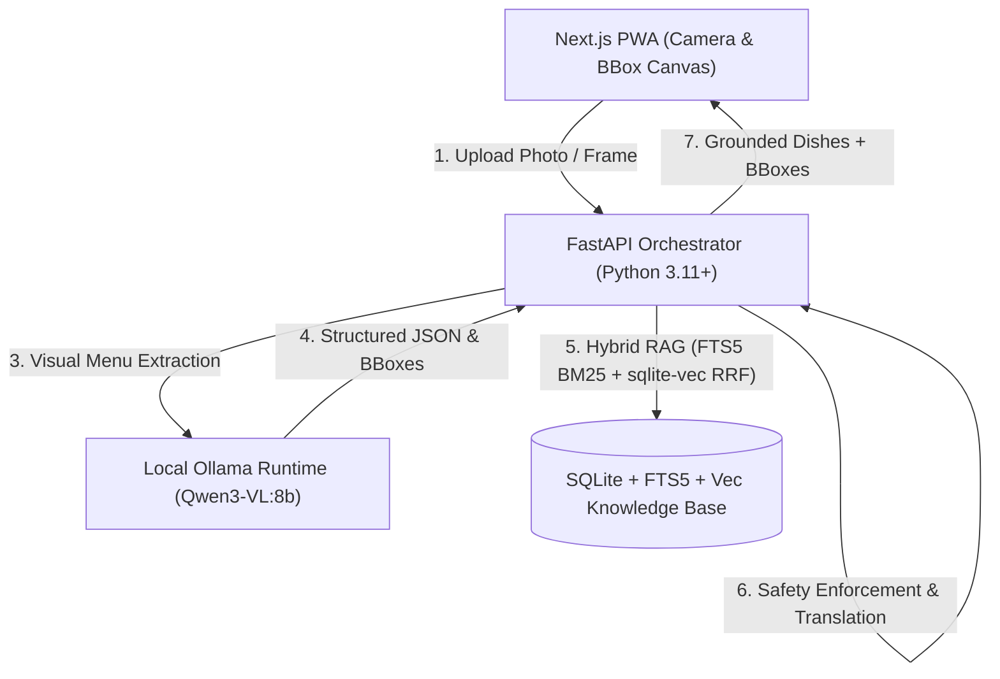

# Menu Translator Architecture

## Overview
Menu Translator is a privacy-first, locally deployable restaurant menu translation and allergen detection application. It operates entirely on-device or within a local network without exfiltrating private diner photos or restaurant recipe data to third-party cloud APIs.

## Core Modules
1. **Frontend PWA (`frontend/`)**: Next.js App Router, React 19, TypeScript, Tailwind CSS, Lucide icons, PWA Web App Manifest, interactive bounding-box overlays over menu photos.
2. **Backend API (`backend/app/api/`)**: FastAPI endpoints for health verification, photo ingestion, extraction, and pipeline orchestration.
3. **Core Services (`backend/app/services/`)**:
   - `health_service.py`: Real-time health diagnostic checks for API, SQLite database, FTS5, `sqlite-vec`, and local Ollama VLM reachability and model availability.
   - `image_processor.py`: EXIF orientation transposition, aspect-ratio preserving downsampling (1024px default), and optional CLAHE contrast equalization.
   - `vision/`: Local Ollama Vision Provider (`qwen3-vl:8b`), defensive JSON parsing, single-retry repair loop, and bounding box normalization.
   - `rag/`: Hybrid knowledge retriever (`CulinaryRetriever`), FTS5 query sanitizer, and knowledge ingestion service (`KnowledgeIngestionService`).
   - `embedding/`: Deterministic 384-dimensional local multilingual vectorizer and `sqlite-vec` binary serializer.
4. **Culinary Knowledge Database (`backend/app/db/`)**:
   - Tables: `restaurants`, `dishes`, `dish_ingredients`, `allergen_evidence`, `knowledge_sources`.
   - Full-text search: `dishes_fts` (FTS5 virtual table synchronized via database triggers).
   - Dense vector storage: `vec_dishes` (`vec0` virtual table with float32[384] embeddings).

## Hybrid RAG Architecture & Reciprocal Rank Fusion (RRF)
For each dish identified in a physical menu:
1. **Exact & Alias Search**: Performs exact case-insensitive matches against canonical native names and alias arrays.
2. **FTS5 Lexical Search**: Runs BM25 full-text queries against `dishes_fts` over native script, transliterations, ingredients, and cultural notes.
3. **Dense Vector Search**: When `sqlite-vec` is loaded, computes 384-d normalized embeddings of query text and retrieves top nearest neighbors by Euclidean distance (`WHERE embedding MATCH ? AND k = ?`).
4. **Reciprocal Rank Fusion**:
   $$RRF(d) = \sum_{m \in \{lexical, vector\}} \frac{1}{k + rank_m(d)}$$
   Using smoothing constant $k = 60$. Exact matches receive an additional top-rank priority boost.
5. **Authoritative Confidence Threshold**: Dishes exceeding threshold $RRF \ge 0.012$ are classified as authoritative matches. Queries with low similarity or no match return `None` rather than forcing a false positive match.
6. **Strict Restaurant Isolation**:
   - When `restaurant_id` is specified: search strictly filters to recipes owned by that restaurant or public global recipes. Private recipes belonging to other restaurants are never included.
   - When `restaurant_id` is omitted: search strictly restricts to public global recipes (`restaurant_id IS NULL`). No restaurant's proprietary recipe is ever leaked in unscoped queries.
7. **Graceful Lexical-Only Fallback**:
   If the `sqlite-vec` native extension cannot be loaded, the system automatically falls back to FTS5 BM25 search and explicitly reports `vector_status: fallback_lexical_only` in `/api/v1/health` and retrieval diagnostics.

## Data Ingestion & Preservation Policy
- Ingestion supports structured JSON and CSV formats via `KnowledgeIngestionService` and `scripts/ingest_culinary_data.py`.
- Row-level validation using Pydantic models records exact line-item errors without terminating the batch.
- **Verified Record Protection**: Incoming unverified records cannot overwrite existing verified dishes unless the explicit policy flag `allow_overwrite_verified=True` is provided.

## Allergen Safety Protocol
- Absence of evidence is not evidence of absence: an inferred allergen absence is **never** presented as proof that a dish is safe.
- Ingredients are categorized into `confirmed`, `possible`, and `unverified`.
- At all times prior to verified recipe groundings, dishes carry `evidence_status: unverified`.
- Diners with life-threatening allergies are always advised to confirm directly with restaurant staff.
